<div align="center" id="top"></div>

<div align="center">

Inspired by Typora<sup>[diff](#differences)</sup>
</div>

Preview markdown inline and extend the capabilities through existing VS Code extensions.

<details>

<summary>Contents</summary>

- Features
    - [**Headers**](#headers)
    - [**URLs**](#urls)
    - [**Images**](#images)
      - [**Preview on hover**](#preview-on-hover)
      - [**Preview inline**](#preview-inline)
    - [**Inline code**](#inline-code)
    - [**Code blocks**](#code-blocks)
    - [**LaTeX**](#latex)
      - [**Live preview**](#live-preview)
    - [**Emphasis**](#emphasis)
    - [**Highlight**](#highlight)
    - [**Blockquote**](#blockquote)
    - [**Horizontal rule**](#horizontal-rule)
    - [**HTML tags**](#html-tags)
    - [**List**](#list)
    - [**Task list**](#task-list)
    - [**Mermaid**](#mermaid)
    - [**Table**](#table)
    - [**Front matter**](#front-matter)
    - [**Reveal source**](#reveal-source)
    - [**Performance**](#performance)
    - [**Vim bindings**](#vim-bindings)
    - [**Spec compliant**](#spec-compliant)
- [**Extension Settings**](#extension-settings)
- [**Known Issues**](#known-issues)
- [**FAQ**](#faq)
- [**Contributing**](#contributing)
- [**Relevant extensions**](#relevant-extensions)
- [**Typora equivalents**](#typora-equivalents)
- [**Differences**](#differences)
</details>

<div id="features"> </div>

# **Headers**

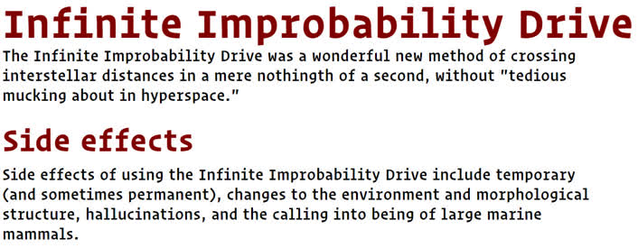

# **URLs**

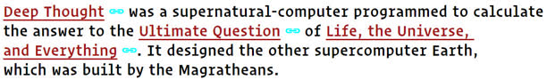

# **Images**

(and gifs!)

Paths are relative to the markdown file, or to the workspace folder when they start with `/`, as in the built-in markdown preview. Images in HTML `` tags are shown too.

## **Preview on hover**

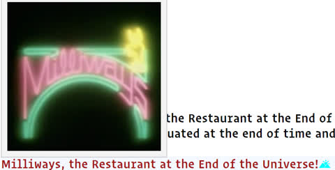

## **Preview inline**


# **Inline code**

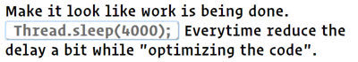

# **Code blocks**

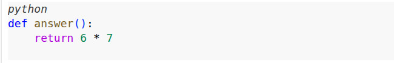

# **LaTeX**

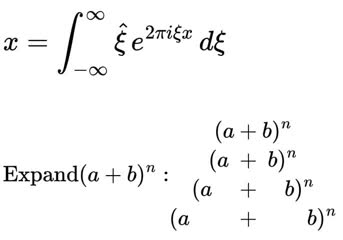

`$..$` for inline blocks and `$$..$$` for multiline blocks.

## **Live preview**

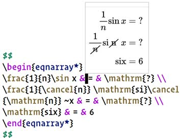

# **Emphasis**

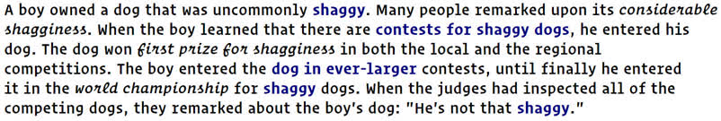

# **Highlight**

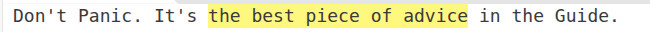

`==text==` is highlighted. The color can be changed with `markless.highlightBackground` in `workbench.colorCustomizations`.

# **Blockquote**

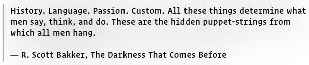

# **Horizontal rule**

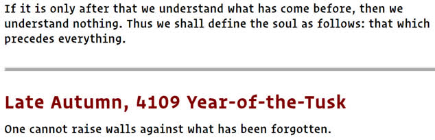

# **HTML tags**


 
# **List**


Ordered lists keep their numbers. The symbols of unordered lists are set with `markless.listBullets`, for example `["•", "◦", "▪"]` for the usual round bullets or `[]` to keep the markers as typed.

# **Task list**

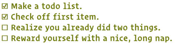

# **Mermaid**

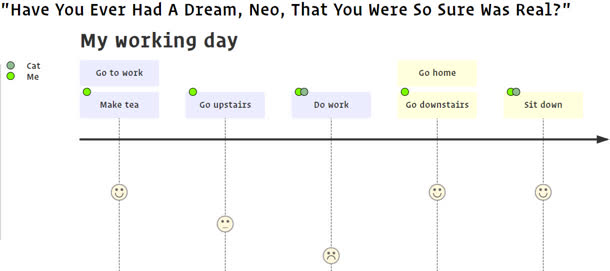

Use `mermaid` as the language specifier in the code block. A diagram is scaled to the lines of its code block; add lines to the block to make it bigger.

Diagrams are drawn by a view in the Markless side bar, which is shown for a moment when the first diagram is rendered.

# **Table**

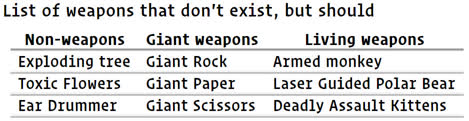

# **Front matter**

YAML (`---`) and TOML (`+++`) front matter is left as it is.

# **Reveal source**

The concealed elements near the cursor are auto-revealed.

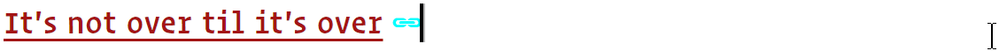

To show all concealed elements, use the toggle button on the top-right. Alternatively, use the provided <kbd>Ctrl+Shift+m</kbd> shortcut. To reveal only the current line, toggle with <kbd>Ctrl+Shift+space</kbd>.

# **Performance**

The extension intelligently parses only the visible text for large files and employs caching extensively. Entire rendering takes well [under 100ms](https://www.pubnub.com/blog/how-fast-is-realtime-human-perception-and-technology/).

# **Vim bindings**

The implementation uses the native editor instead of [Custom UI](https://code.visualstudio.com/api/extension-guides/custom-editors). All extensions should work as expected _including_ [Neo Vim](https://github.com/asvetliakov/vscode-neovim/).

# **Spec compliant**

The parser follows the Github Flavoured Markdown (thus Commonmark) spec. It prevents inconsistency with the formats exported with spec compliant renderers.

# **Extension Settings**

Look under _Markless_ section to selectively turn off the eye candies.

<details>

<summary>Add the following in settings.json for better rendering.</summary>

```json
"editor.tokenColorCustomizations": {
    "textMateRules": [
        {
            "scope": "markup.list",
            "settings": {
                "foreground": "#6c7500",
                },
        },
        {
            "scope": "markup.bold",
            "settings": {
                "fontStyle": "bold",
            },
        },
        {
            "scope": "markup.heading",
            "settings": {
                "fontStyle": "bold",
            },
        },
        {
            "scope": "markup.inline.raw",
            "settings": {
                "fontStyle": "bold",
                "foreground": "#707070",
            },
        },
        {
            "scope": "string.other.link.title.markdown",
            "settings": {
                "fontStyle": "underline",
            },
        },
    ],
},
```
</details>


# **Known Issues**

Bracket pair colorizers interfere with the rendering. If you use one, install the [patched version](https://github.com/tejasvi/rainbow-brackets-2) which excludes the markdown files.

With word wrap on, lines with links wrap earlier than needed. VS Code decides where to wrap from the full text, including the hidden URLs, and extensions cannot change that.

-----------------------------------------------------------------------------------------------------------

# **Relevant extensions**

* [Keyboard Shortcuts, Tables and TOC](https://github.com/yzhang-gh/vscode-markdown)
* [Wikilinks, Backlinks, Tags](https://marketplace.visualstudio.com/items?itemName=foam.foam-vscode)
* [Image paste](https://marketplace.visualstudio.com/items?itemName=telesoho.vscode-markdown-paste-image)
* [Todo lists](https://marketplace.visualstudio.com/items?itemName=fabiospampinato.vscode-markdown-todo)
* [Snippets](https://marketplace.visualstudio.com/items?itemName=robole.markdown-snippets)
* [Linting](https://marketplace.visualstudio.com/items?itemName=starkwang.markdown)
* [Custom CSS](https://github.com/be5invis/vscode-custom-css#getting-started)
* [Vim bindings](https://github.com/asvetliakov/vscode-neovim/)
* [One of yours](https://code.visualstudio.com/api/get-started/your-first-extension)

# **Typora equivalents**

* [Markdown editor](https://github.com/zaaack/vscode-markdown-editor)
* [Mark Text](https://github.com/marktext/marktext)
* [Zettlr](https://github.com/Zettlr/Zettlr)
* [Noteworthy](https://github.com/benrbray/noteworthy)

---

# **FAQ**

## The Comments panel opens when I open a file with images

Image previews are comment threads, and VS Code opens the Comments panel for the first file with comments. Set `"comments.openView": "never"` to stop it.

## How do I keep image previews collapsed?

Set `"markless.inlineImage.autoPreview": false`. Each preview can then be expanded from the comment icon next to its line.

# **Contributing**

See [CONTRIBUTING.md](CONTRIBUTING.md) to build, debug and test the extension.


# **Differences**

|  | Markless | Typora |
| -|-|-|
| Vim bindings | ☑ |  |
| Extensible | ☑ |  |
| Open source | ☑ |  |
| UI Polish | ▣ | ☑ |
| Advanced CSS |  | ☑ |
| iFrame embeds[*](https://github.com/microsoft/vscode/issues/85682) |  | ☑ |