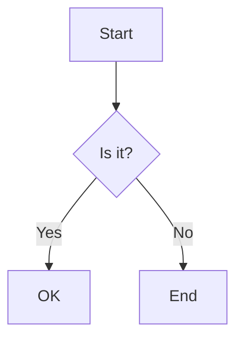

# Heading one

Setext heading
==============

Paragraph with **bold**, *italic*, ~~strike~~, `inline code`, and ==highlighted text== here.

- level one item
    - level two item
        - level three item
- [ ] unchecked task
- [x] checked task

1. first ordered
2. second ordered
    1. nested ordered

```js
function hello() {
  return 42;
}
```



Inline math $E = mc^2$ and display math:

$$
\frac{1}{2} + \sum_{i=1}^{n} i^2
$$

| Left | Center | Right |
|:-----|:------:|------:|
| a    | b      | c     |
| long cell text | 2 | 3 |
| x | y | z |

A long paragraph with [a link](https://www.example.com/some/really/long/path/that/goes/on/and/on) and another [link two](https://www.example.com/another/long/path/to/demonstrate/wrapping) inside it so that word wrap is needed when the window is narrow enough to wrap.


> A quote
> spanning two lines

---

Final line.

- item with code
    ```sh
    echo nested
    ```
